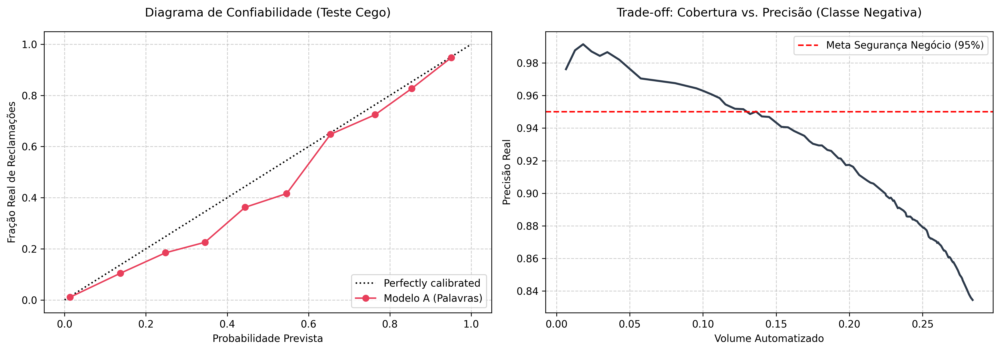

# Triagem de Avaliações com Abstenção Calibrada (Olist)

Prova de conceito de Machine Learning para triagem binária de avaliações de e-commerce em português (`0` = positiva, notas 4–5; `1` = negativa, notas 1–2). Em vez de forçar o modelo a classificar 100% dos textos, o sistema utiliza **abstenção dupla calibrada**: automatiza apenas predições cuja confiança atinge o limite inferior de Wilson de 95% na validação e encaminha os casos incertos (`-1`) para revisão humana.

## Links do Projeto
- **Notebook de Análise e Execução (Kaggle):** https://www.kaggle.com/code/davicmaciel/triagem-de-avalia-es-olist
- **Modelo Empacotado & Model Card (Hugging Face):** https://huggingface.co/DaviCM/olist-review-triage-calibrated

---

## Arquitetura e Engenharia de Confiabilidade
1. **Isolamento por Cliente e por Tempo:** Divisão cronológica estrita (26.320 avaliações no passado para treino/validação; 6.482 no futuro para teste cego), removendo do teste qualquer `customer_unique_id` já visto anteriormente e deduplicando textos exatos.
2. **Calibração Fora-da-Dobra (Out-of-Fold):** O modelo base (TF-IDF + Regressão Logística) é calibrado via Regressão Isotônica utilizando `GroupKFold` (5 folds agrupados por cliente), impedindo o ajuste excessivo das probabilidades na validação.
3. **Limiares pelo Limite Inferior de Wilson:** Os cortes de decisão são buscados na validação para que o limite inferior do intervalo de confiança de Wilson (95%) atinja no mínimo `0.95`, penalizando amostras pequenas.

---

## Comparativo de Modelos (Teste Temporal Cego — 6.482 avaliações)
No conjunto de teste inédito, **73,7% (4.777)** das avaliações são positivas e **26,3% (1.705)** são negativas. Os intervalos de confiança de 95% dos Modelos A e B se sobrepõem (diferença dentro do ruído amostral); o **Modelo A (Palavras)** foi adotado por simplicidade.

| Abordagem / Modelo | Cobertura Global | Precisão / Acurácia Global | Negativas automatizadas (% do teste) | Precisão Negativas | ECE |
| :--- | :--- | :--- | :--- | :--- | :--- |
| **Baseline 1 (Sempre "Positiva")** | 100,0% | 73,70% | 0,0% | - | - |
| **Baseline 2 (Sem Calibração/Abstenção, corte 0.5)** | 100,0% | 93,43% | - | - | - |
| **Modelo A (TF-IDF Palavras + Wilson)** | **74,21%** (4.810) | **96,96%** (IC: 96,4%–97,4%) | **3,47%** (225) | **98,67%** | **0.0142** |
| **Modelo B (TF-IDF Caracteres 2-5 + Wilson)** | 74,48% (4.827) | 96,42% (IC: 95,8%–96,9%) | 3,27% (212) | 98,11% | 0.0146 |

---

## Análise de Erros Qualitativa (Amostra Real do Teste)
A inspeção dos registros reais do conjunto de teste evidencia tanto a eficácia do filtro de abstenção quanto os limites de um modelo puramente lexical:

* **O que a abstenção reteve corretamente para revisão humana (`decisao = -1`):**
  * Reclamações explícitas que ficaram logo abaixo do corte rígido de `0.9664` devido ao conservadorismo do limite de Wilson (ex.: relato de defeito em relógio após 1 hora de uso com `p_neg = 0.914`; falha de encaixe em cadeiras com `p_neg = 0.914`; dificuldade para solicitar troca no site com `p_neg = 0.960`).
* **O que a automação ainda erra (reclamações classificadas como elogio, `Real = 1` mas `Prev = 0`):**
  * **Texto misto com elogio inicial:** Comentário elogiando o produto antes de relatar odor forte (`p_neg = 0.061`).
  * **Erro de ortografia / vocabulário fora do dicionário:** Palavra isolada com grafia incorreta (*"ruin"*, `p_neg = 0.169`), não capturada pelo TF-IDF de palavras com `min_df=2`.
  * **Ruído de rótulo (proxy da nota):** Clientes que deram nota 1 ou 2, mas escreveram apenas elogios sobre prazo ou qualidade do material (`p_neg = 0.005` e `p_neg = 0.008`).

---

## Limitações e Escopo
* **Automação concentrada nas avaliações positivas:** Dos 4.810 casos automatizados pelo Modelo A, **4.585 (95,3%)** são positivas seguras e apenas **225** são negativas seguras. Isso representa **13,2% do total de 1.705 reclamações** do teste — a maioria das avaliações negativas (86,8%) continua sendo direcionada para revisão humana.
* **Proxy de rótulo:** O uso do `review_score` (1–2 vs. 4–5) introduz ruído inerente, pois alguns usuários atribuem notas baixas acompanhadas de comentários neutros ou positivos (e vice-versa). Notas 3 foram removidas por ambiguidade.
* **Deduplicação e período:** Os dados são de 2016–2018 (marketplace Olist) e passaram por remoção de textos idênticos, o que elimina mensagens curtas repetidas e subestima a cobertura real em produção.
* **Uso:** Prova de conceito arquitetural; não está implantado em produção comercial (dados sob licença CC BY-NC-SA 4.0).

---

## Como Reproduzir
1. Clone o repositório e instale as dependências (Python 3.13):
   ```bash
   git clone https://github.com/DaviCMaciel/triagem-avaliacoes-olist.git
   cd triagem-avaliacoes-olist
   pip install -r requirements.txt
   ```
2. Baixe o dataset [Brazilian E-Commerce Public Dataset by Olist](https://www.kaggle.com/datasets/olistbr/brazilian-ecommerce) (licença CC BY-NC-SA 4.0) e coloque os CSVs `olist_order_reviews_dataset.csv`, `olist_orders_dataset.csv` e `olist_customers_dataset.csv` em `data/` (pasta ignorada pelo Git).
3. Abra `notebooks/triagem-de-avaliaces-olist.ipynb`. Ele foi executado no Kaggle: ajuste os caminhos `/kaggle/input/...` da célula 3 para `data/` ao rodar localmente. A última célula (deploy no Hugging Face) exige um token `HF_TOKEN` e pode ser ignorada.
4. O mesmo núcleo do notebook (Wilson, ECE, limiares, abstenção e `treinar_e_avaliar`) está em `src/triagem.py` para ser importado como módulo.

## Estrutura do Repositório
```
├── notebooks/   # Análise e execução completa (saídas incluídas)
├── src/         # Motor de triagem reutilizável (Wilson, calibração, abstenção)
├── docs/        # Diagnóstico visual (curva de confiabilidade e trade-off)
├── requirements.txt
└── README.md
```



## Licença

Este projeto adota licenciamento duplo para respeitar os direitos dos dados originais utilizados no treinamento:

- **Código-fonte e Notebooks:** Licenciados sob a **MIT License** — você pode usar, modificar e distribuir livremente o código para fins pessoais ou comerciais.
- **Dados e Pesos do Modelo Treinado (`.skops`):** Licenciados sob **CC BY-NC-SA 4.0** (*Creative Commons Attribution-NonCommercial-ShareAlike 4.0*), em conformidade com a licença do *Brazilian E-Commerce Public Dataset by Olist*. Uso estritamente não comercial e acadêmico.